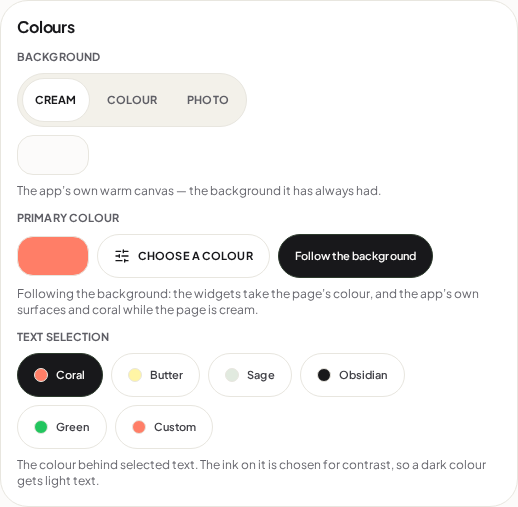
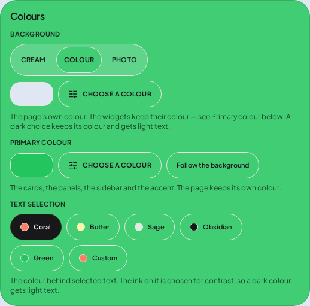
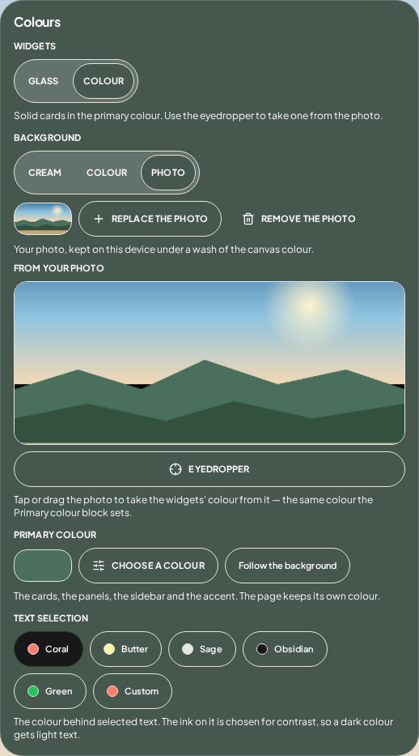
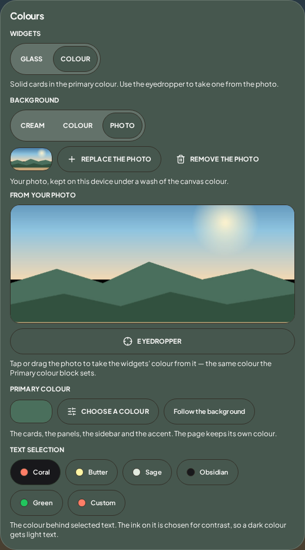
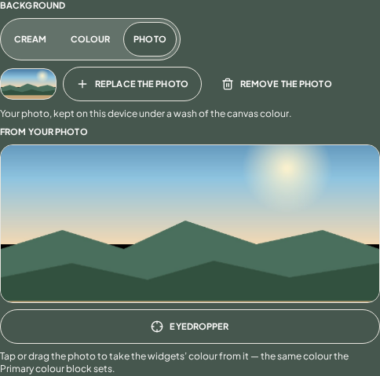
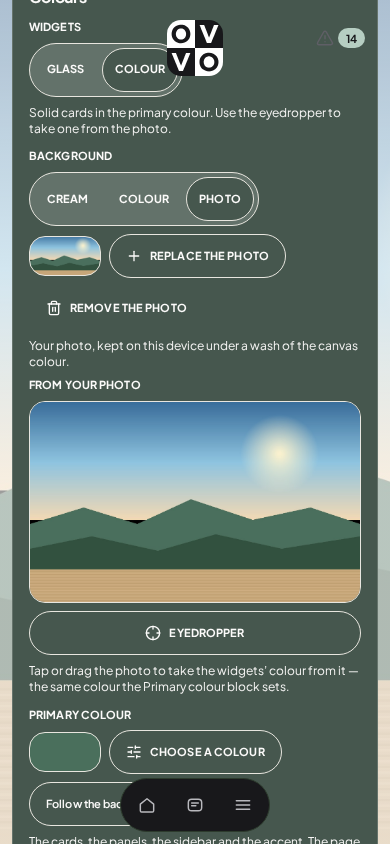
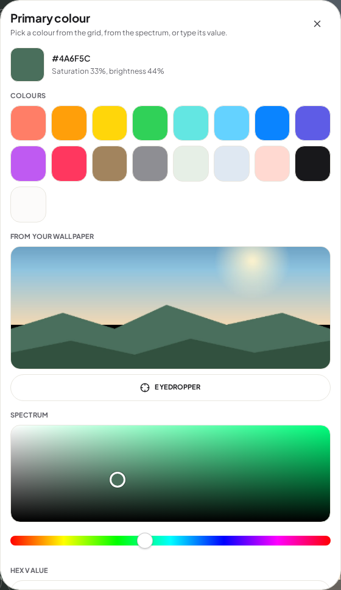
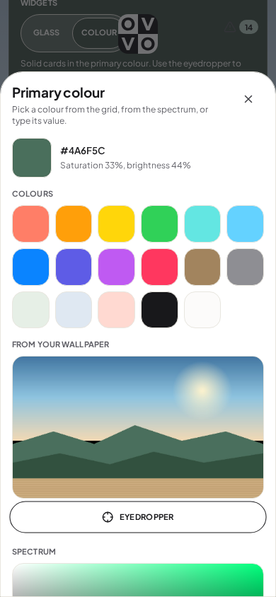

# Colours — the redesign plan

Status: **implemented** (2026-10-19; rationale in `DESIGN_DECISIONS.md` R113, work log in
`USER-FIXES.md`). The plan is kept as written — the four answers it was waiting on, and the points
where the build differs from it, are recorded at the end under *As built*.
Everything below marked *(measured)* was measured on the running app, on the current code, at
1440×1100 and 390×844; the script is `.logs/colours-plan-measure.cjs` and its output is
`.logs/colours-plan-measure.txt`.

The order: *"redesigning the colour section completely, including my suggestion about a full-screen
colour picker and a full screen cropper for the uploaded image."* The complaint it answers: *"Eyedropping
a colour from the background is currently a horrible experience, you have no way of seeing what your
currently Eyedropping, a big part of the image gets cropped off, it looks messy in settings."*

---

## 1. Screenshots of the section as it stands

Captured by `.logs/colours-plan-shots.cjs` into `review/colours-before/` (tracked, so the plan can
point at them). Read this section first — the plan is a response to these pictures. The photograph in
them is drawn by the script (sky, sun, three hills, a paved foreground) rather than borrowed, so the
shots carry no third-party image and the crop is easy to see: every band that is lost is a recognisable
shape.

### Cream — the baseline, and already a stray pill



Three blocks in one card: **Background** (Cream / Colour / Photo), **Primary colour** (a swatch, a
button, a chip), **Text selection** (five chips and Custom). The section is 506px tall *(measured)* and
holds 11 buttons *(measured)*. The empty rounded rectangle under the Background segmented control is
the preview swatch, drawn with no colour in cream mode — a control-shaped nothing.

### A colour page under a different widgets' colour — the "split"



The page is pale blue, the widgets are green, and because this card *is* a card, the whole Colours
section is therefore painted green. Inside it, the pale-blue chip is the page's colour trying to
describe itself from inside the widgets' colour. Every label, chip and hairline has to survive one
surface while describing another.

### A photo with solid widgets — a green slab in both appearances





These two are the same state in light and dark appearance. The card is `rgb(70, 87, 78)` *(measured)*
in both, with `rgb(252, 251, 250)` ink: once a widgets' colour is in force, appearance changes
nothing here, because the card is the traveller's colour. The section grows from 506px to
**932px** *(measured)*, and the **Background** block moves **113px** down *(measured)* because a
**Widgets** row (Glass / Colour) appears above it only in photo mode. A section that reorders itself
between three modes is most of the "messy" feeling, independently of the photo.

### The sampler itself — the band



The picture is drawn into a `200px`-tall box with `object-fit: cover` *(measured:
`{box: [482, 200], intrinsic: [480, 320], objectFit: "cover"}`)*, so **38% of its height is cropped
away** on desktop *(measured)* and 9% on a 390px phone *(measured)*. A finger covers what is left. The
only feedback while dragging is the settings card *behind* the picture changing colour, which is
usually outside the viewport. The platform **Eyedropper** is a full-width button under the picture, so
the one action that samples anything already visible is the widest control in a settings card.

### The same block on a phone



At 390 the card is **1085px tall** *(measured)* in an 844px viewport, so the section is scrolled like a
page rather than read like a setting; the app's own header and dock sit over it as they do over any
page. The two photo actions wrap onto two rows, then the picture, then a full-width **Eyedropper** — four
stacked controls for one question.

### The sheet, and where its footer goes





The sheet carries the grid (17 swatches, three rows), the wallpaper sampler, the spectrum, the hue
strip and the hex field. At 1440 its panel is 968px with a 918px scrolling body *(measured)* and the
**Done** button is **below the fold** *(measured: `doneVisible: false`)*. At 390 the body is 900px in
a 743px panel and Done sits at y=1111 in an 844px viewport *(measured)* — two scrolls to finish a
colour. This is the surface the full-screen picker replaces.

---

## 2. What is actually wrong — six things, in order of weight

1. **There is nowhere to see what you are sampling.** The picture is a 200px band, no loupe, no
   crosshair, no live swatch, and the colour it writes is only visible on the card behind it.
2. **A third of the picture is cropped,** and the traveller never chose that crop. The page itself
   crops again with `background-size: cover` and `background-position: center` (`styles/base.css`),
   so even the part that survives the band is not necessarily what the page shows.
3. **The section describes two colours from inside one of them.** Picking a widgets' colour repaints
   the card that holds the page's colour control. In the split state the page-colour chip is a
   foreign object.
4. **The section reorders itself between modes** (the Widgets row appears above Background in photo
   mode only), so the controls move under the hand that is using them.
5. **Two doors to colour, two samplers.** Background has its sampler and a "Choose a colour" button;
   Primary colour has its sheet, which has a second sampler. The same picture appears twice in two
   different frames and writes two different settings depending on which one is used.
6. **The sheet is a form, not a colour.** Grid + wallpaper + spectrum + hue + hex in a scrolling
   panel whose commit button can be off screen; on a phone it is a page of scrolling to change one
   value.

Plus three smaller defects worth fixing in the same pass: the blank preview pill in cream mode; the
40px swatch beside **Primary colour** that names nothing; and Text selection's chips wrapping into two
rows at phone width simply because the card is full.

---

## 3. The redesign, in one paragraph

**The settings card stops drawing colours and starts naming them.** Three rows, one action each, no
inline picture, no wrapping chip rows, no control that appears and disappears between modes. Pressing
a row's action opens a **full-screen surface** that owns the whole job: one for choosing any colour, one
for seeing and sampling the photograph, one for cropping a newly chosen photograph. The sections keep
their size and order in every mode, and the photograph never appears in Settings smaller than it can be
understood at.

```
Settings → Colours                     Settings → Colours (the proposal)
┌──────────────────────────────┐       ┌──────────────────────────────┐
│ Background                   │       │ BACKGROUND                   │
│ [Cream][Colour][Photo]       │       │ Cream · Colour · Photo       │
│ ▢  + Replace  🗑 Remove      │       │ ┌────────┐                   │
│  [ 200px cropped band  ]     │       │ │ 48×48  │ Cream             │
│  [     EYEDROPPER     ]      │       │ └────────┘  Choose…  ›        │
│  tap or drag the photo…      │       ├──────────────────────────────┤
│ Primary colour               │       │ WIDGETS                      │
│ ▢  [Choose a colour] [Follow]│       │ ┌────────┐                   │
│ Text selection               │       │ │ 48×48  │ Follow the page   │
│ [Coral][Butter][Sage]        │       │ └────────┘  Choose…  ›        │
│ [Obsidian][Green][Custom]    │       │ Glass / Solid             │
│  the colour behind …         │       ├──────────────────────────────┤
└──────────────────────────────┘       │ TEXT SELECTION               │
   506 → 932px, reorders               │ [Coral][Butter][Sage][…]      │
                                       └──────────────────────────────┘
                                            same height in every mode
```

---

## 4. The three screens

Each is the existing `FullScreen` primitive (`components/ui/FullScreen.tsx`): back arrow left, centred
title, right slot for the one thing that finishes. Escape is Back, as it is today on the map.

### 4a. Colour screen — `Background colour`, `Primary colour`

```
┌────────────────────────────────────────────┐
│ ‹   Background colour              Done    │
├────────────────────────────────────────────┤
│  ┌────────┐  #DFE8F2                       │
│  │        │  Saturation 12%, brightness 95%│
│  │ 96×96  │  Ink on it: dark · 13.2:1       │
│  └────────┘                                │
│                                            │
│  COLOURS                                   │
│  [ ][ ][ ][ ][ ][ ][ ][ ]                  │
│  [ ][ ][ ][ ][ ][ ][ ][ ]                  │
│  [ ][ ][ ][ ][ ][ ][ ]                     │
│                                            │
│  FROM YOUR PHOTO                    ›      │  ← only when there is a photo
│  ┌────┐ Use a colour taken from the picture│
│  └────┘                                    │
│                                            │
│  SPECTRUM                                  │
│  ┌────────────────────────────────────────┐│
│  │                                        ││
│  └────────────────────────────────────────┘│
│  ▬▬▬▬▬▬▬▬▬▬▬▬▬▬▬▬▬▬▬▬▬▬▬▬▬▬▬▬▬▬▬▬▬▬▬▬▬    │
│  HEX VALUE   ┌──────────────────────────┐  │
│              │ #dfe8f2                  │  │
│              └──────────────────────────┘  │
└────────────────────────────────────────────┘
  the body scrolls on a phone; the title and Done never do
```

- **One screen for both colours**, with the title naming which one: *Background colour* or *Primary
  colour*. Same grid, same spectrum, same hex — one component, one set of rules.
- **Done lives in the bar's right slot**, so it is on screen at every width and at every scroll
  position. That is the fix for the sheet whose footer measured below the fold at both sizes.
- **The hero swatch states the consequence**: the hex, saturation/brightness, and *the ink that will
  be used on it and its measured ratio* — the same two numbers the app derives anyway
  (`lib/background.ts`), so a dark choice visibly "keeps its colour and gets light text" before it is
  committed.
- **From your photo** is a row, not a picture: a 56px thumbnail, one sentence, a chevron. It opens the
  photo screen. Present only when `backgroundImage` exists, which is the one conditional in this
  screen and it does not move anything else.
- **Writes live.** Every change is the setting (as today), so Back keeps what you saw; there is no
  Cancel/Apply pair to get wrong.

### 4b. Photo screen — where a colour is taken out of the picture

```
┌────────────────────────────────────────────┐
│ ‹   From your photo                Done    │
├────────────────────────────────────────────┤
│                                            │
│        ┌──────────────────────────┐        │
│        │                          │        │
│        │   the whole photograph,  │        │
│        │   contain, no crop       │        │
│        │        ╭─────╮           │        │
│        │        │ 6×  │← loupe     │        │
│        │        │  ╳  │           │        │
│        │        ╰─────╯           │        │
│        └──────────────────────────┘        │
│                                            │
│  ┌────┐  #4A6F5C    taken from the hills   │
│  │new │  ▁▁▁▁▁▁▁▁▁ contrast 7.4:1          │
│  └────┘                                    │
│  [   Eyedropper   ]   [  Crop the photo  ] │
└────────────────────────────────────────────┘
```

- **The whole picture, uncropped.** `object-fit: contain` inside the available body, letterboxed on the
  canvas with the wash behind it, so nothing is lost and nothing is stretched. This is the direct answer
  to "a big part of the image gets cropped off".
- **A visible eyedropper.** A 112px circular **loupe** rides above the pointer (above the finger, so the
  finger never covers the pixel), showing a 6× magnification of the pixels around the sample point with
  a crosshair. A hex chip is attached to it. Dragging sweeps the picture and the colour updates live.
- **The colour is shown twice**: the loupe at the point, and a persistent swatch row at the foot
  (`#4A6F5C`, the words it came from — "the hills" is optional, see open question 3) with the ink
  ratio the app will use on it. Both update while dragging, so the answer is visible *before* letting
  go, which today it is not.
- **The platform's `EyeDropper`** becomes a secondary button here, for sampling anything else on the
  screen, where the browser has it. It is no longer a full-width row in a settings card.
- **Keyboard**: arrows nudge the sample 1px (Shift 10px), Enter commits and goes back, Escape backs out
  without committing (the colour from before the screen opened is restored — see §7).
- **Touch**: press-and-hold to sample without committing; the loupe appears on the first move; releasing
  commits. A tap commits immediately.

### 4c. Crop screen — the photograph, framed by the traveller

```
┌────────────────────────────────────────────┐
│ ‹   Crop the photo                  Save   │
├────────────────────────────────────────────┤
│  ┌──────────────────────────────────────┐  │
│  │  ▒▒▒▒▒▒▒▒▒▒▒▒▒▒▒▒▒▒▒▒▒▒▒▒▒▒▒▒▒▒▒▒▒▒  │  │
│  │  ▒▒▒┌──────────────────────┐▒▒▒▒▒▒▒  │  │
│  │  ▒▒▒│                      │▒▒▒▒▒▒▒  │  │
│  │  ▒▒▒│   the frame, drag   │▒▒▒▒▒▒▒  │  │
│  │  ▒▒▒│   to move, pinch to  │▒▒▒▒▒▒▒  │  │
│  │  ▒▒▒│   zoom               │▒▒▒▒▒▒▒  │  │
│  │  ▒▒▒└──────────────────────┘▒▒▒▒▒▒▒  │  │
│  │  ▒▒▒▒▒▒▒▒▒▒▒▒▒▒▒▒▒▒▒▒▒▒▒▒▒▒▒▒▒▒▒▒▒▒  │  │
│  └──────────────────────────────────────┘  │
│  FRAME   [ Fill the screen ][ Phone ][ Free ]│
│  [ Reset ]              [   Save the crop  ]│
└────────────────────────────────────────────┘
```

- Opens immediately after a file is chosen ("Choose a photo" / "Replace the photo"). Choosing a file no
  longer silently applies a centre crop.
- **Zoom and position** with wheel/pinch and drag; the area outside the frame is dimmed, not hidden, so
  it is obvious what will be lost. A rule-of-thirds grid fades in while dragging.
- **Frame chips**: *Fill the screen* (the current behaviour, made visible), *Phone* (9:16), *Free* —
  drag the frame's corners. Default: the aspect of the viewport the crop screen is open in, because that
  is the surface the photo is drawn on.
- **Save** bakes the crop at full resolution and only then downscales to the stored maximum edge, so a
  tight crop keeps more detail than the current "downscale first, crop later" path can.
- **The crop is viewport-dependent, so the focal point is kept.** `styles/base.css` draws the photo
  `cover`, `center`, `fixed`; a crop saved for a 1440px desktop is re-cropped again by a 390px phone.
  Saving therefore also stores the frame's centre as a percentage, written to `background-position`, so
  the subject the traveller framed stays in view on every screen. (Storage: two numbers.)

---

## 5. The data model

One new setting, one changed flow, no new image:

| field | change |
|---|---|
| `backgroundImage` | unchanged in type (`#…` data URL, JPEG). Becomes the **output** of the crop screen rather than the raw upload. |
| `backgroundFocus` | **new**, `{ x: number; y: number }` as percentages, default `{ x: 50, y: 50 }`. Written by the crop screen, read by `applyBackground` as `background-position: x% y%`. It is the only thing that makes a baked crop keep its subject across screen sizes. |
| `backgroundColour`, `primaryColour`, `cardTreatment`, `selectionColor`, `selectionCustom` | unchanged. |

- `SETTINGS_VERSION` 5 → 6, with one migration step that supplies `{ x: 50, y: 50 }` (the same
  centre crop every existing browser already has, so nothing moves for anyone who does not re-crop).
- **No second copy of the picture.** A "keep the original + crop numbers" model would let a crop be
  redone losslessly, but it doubles a ~100–200 kB data URL in `localStorage` and adds a render path
  (`background-size`, `background-position` and a zoom factor must agree with the crop screen's
  preview at every viewport). Baking is one field, one render path, and re-cropping the stored 1600px
  JPEG is visually indistinguishable at the sizes this app draws. If re-crop quality ever becomes a
  complaint, that is the moment to revisit it — not before.
- A **partially sampled colour is not a setting.** The photo screen holds its sample in component state
  and writes once on commit, so dragging across a picture does not write settings on every move (today
  the settings object is rewritten on every pointer move).

---

## 6. Files

New:

| file | what it is |
|---|---|
| `src/components/ui/ColourScreen.tsx` | the full-screen colour picker (§4a). Absorbs the grid, spectrum, hue and hex from `ColorPicker.tsx`. |
| `src/components/ui/PhotoScreen.tsx` | the full-screen sampler (§4b): contain-fit picture, loupe, live swatch, platform eyedropper, entry to the crop screen. |
| `src/components/ui/PhotoCropScreen.tsx` | the full-screen crop (§4c): frame, zoom, pan, aspect chips, reset, save. |
| `src/lib/photoCrop.ts` | pure geometry (frame ↔ image mapping, clamping, aspect maths) and `bakeCrop(bitmap, frame, maxEdge)` — crop at full resolution, then downscale. Testable without a browser. |

Changed:

| file | change |
|---|---|
| `src/pages/SettingsPage.tsx` | the Colours card becomes three summary rows (§3). Delete the inline `PhotoSample`, the two preview pills, and the two `ColorPicker` mounts; add the three screen mounts and the crop-after-choose flow. |
| `src/components/ui/ColorPicker.tsx` | **delete** the sheet and `PhotoSample`; its parts move to `ColourScreen.tsx` / `PhotoScreen.tsx`. |
| `src/lib/background.ts` | write `background-position` from `backgroundFocus`; add `bakeCrop`'s counterpart to the image pipeline (`readImageFile` keeps validating size and type). |
| `src/state/types.ts` | `backgroundFocus`, version 6, migration. |
| `src/lib/i18n.ts` | ~20 new Dutch strings; delete the ones that only the sheet used. |
| `src/styles/components.css` | new block for the three screens and the loupe (~220 lines), and the removal of `.color-picker` and `.color-picker__photo`. |
| `scripts/caps-audit.mjs` | the photograph is no longer a settings control: check the new screens' captions instead. |

Deleted: the `.color-picker` sheet, `PhotoSample`, `.color-picker__photo`, `.bg-preview` as a
standalone empty pill, and the "From your wallpaper" wording (one picture, one name: **From your
photo**).

---

## 7. Behaviour the plan commits to

| question | answer |
|---|---|
| Does the screen write as you go, or on Done? | **Colour screen: as you go** (Back keeps it, there is nothing to cancel). **Photo screen: on commit** (the colour under the finger is not a decision; the one you leave with is), with Back restoring what was there when it opened. |
| What if the browser has no `EyeDropper`? | The loupe and the picture still work — they read canvas pixels, not the platform API. The platform button is simply absent, as it is today. |
| What about `prefers-reduced-motion`? | The loupe appears and follows without a spring; no transitions on the screen's entry. |
| Screen readers | The photo screen announces the sampled hex through a polite live region, throttled to the value actually committed (not every pixel); the loupe is `aria-hidden`; the picture is a labelled `img` with a keyboard path that does not need the pointer. |
| Keyboard reach | Every control on all three screens is reachable and operable by keyboard; arrows nudge the sample; Enter commits; Escape backs out. |
| Performance | The picture is decoded **once** per screen into a ≤2048px canvas (`createImageBitmap`, as `background.ts` already does), sampling is a single `getImageData(1×1)`, the loupe is drawn from a second small canvas on `requestAnimationFrame`, and no setting is written during a drag. |
| Contrast | The sampled colour is written as `primaryColour`; the ink ratio shown on the screen is the same number `lib/background.ts` will derive, so the screen cannot promise a readable card it will not deliver. |

---

## 8. Order of work

1. `lib/photoCrop.ts` + unit checks (pure geometry: frame→image mapping, clamping at edges, aspect
   presets, bake size). No UI.
2. `FullScreen` variant with a non-scrolling body (`flush`), so the picture screens own the viewport.
3. `ColourScreen.tsx`, wired to both colour rows; delete the sheet and the two `ColorPicker` mounts.
4. `PhotoScreen.tsx` with the loupe and the live swatch, reachable from the **From your photo** row.
5. `PhotoCropScreen.tsx` after file choice; `backgroundFocus` written and read by `applyBackground`.
6. Settings card reduced to summary rows; remove the inline sampler, the blank pill, and the
   mode-dependent Widgets row (which becomes a treatment row present only over a photo, below the
   widgets' colour — same position every time, so nothing above it moves).
7. Documentation: `DESIGN_DECISIONS.md` (R113), `USER-FIXES.md`, and the probes below.

---

## 9. How it will be verified

| check | what it must prove |
|---|---|
| `.logs/colours-redesign.cjs` *(new, ~26 assertions)* | three rows and no inline picture in Settings; each opens the right screen; Done is inside the viewport at 390, 768 and 1440 without scrolling; the sampled colour is the pixel under the pointer on an uncropped picture; the whole picture is visible (`contain`) and its aspect is preserved; the loupe follows the pointer and shows the same colour as the swatch; a drag writes **once** on release; Back restores the pre-screen colour; the crop screen's frame maps to the baked image (crop a known band of the four-band test picture, then assert the stored JPEG's corner pixels); `backgroundFocus` keeps the framed centre after a 390px reload. |
| `.logs/photo-eyedropper.cjs` | rewritten against the photo screen (the band-based crop assertions retire with the band). |
| `.logs/colours-section.cjs` | updated: the sheet assertions become screen assertions; the split palette, the default and Reset stay exactly as they are. |
| `.logs/custom-native-picker.cjs` | one assertion changes legitimately: Background's *Choose a colour* was asserted to open `/\.color-picker/`, and it now opens a full-screen surface. Text selection's device dialog is untouched. |
| `tint-check`, `tint-contrast`, `colour-and-background`, `palette-names` | unchanged assertions; the eyedropper case moves to the new screen. |
| `class-audit`, `ui-audit`, `caps-audit`, `breakpoint-audit`, `consistency-audit` | green, with the new classes accounted for and the deleted ones gone. |
| Screenshots | the same eleven states as §1, after the change, for a before/after pair. |

---

## 10. What this deliberately does not change

- **Text selection's Custom stays the device's colour picker.** R109 settled that: a chip named after
  the platform is the platform's, and the app's own sheet was the wrong answer there. The full-screen
  picker is for the two colours the app owns.
- **The tint model stays.** Page colour and widgets' colour remain two settings with their own cuts of
  the accent (R111); this plan changes how they are chosen, not what they mean.
- **The map keeps its own palette.** Nothing here touches `--map-accent` or the map's ink reset.
- **The glass/solid treatment stays**, but its switch moves out of the Background block (where it
  appeared and disappeared) to the widgets' row, where it belongs.

---

## 11. Open questions

1. **Crop frame default** — the viewport's aspect (what the page actually draws), *Phone* (9:16), or
   *Fill* (16:9)? The plan assumes the viewport's aspect, with the chips to override.
2. **Does the photo screen need to say where the colour came from** ("the hills"), or is the hex plus a
   swatch enough? Saying where means naming regions of a photograph, which no code can do honestly;
   the plan leaves it out unless you want a free-text note.
3. **Should the sampler be reachable from the home screen too** — long-press the background, *Take a
   colour from the photo* — or is Settings the only door?
4. **Text selection in the same card?** The plan keeps it (it is a colour), but it is the third
   question in a section named for two. Moving it under Appearance would make the Colours card exactly
   two rows on every screen.

---

## As built

The four questions were answered by the order, and the build follows them:

1. **Crop frame default — the screen's own aspect.** *This screen* is the default chip; the preview at
   the foot is the page's own two-layer drawing at that shape, so what the frame shows is what the page
   draws. Phone (9:16) and Square are the other two.
2. **Crop is offered, never automatic.** Choosing a file applies the whole picture; **Crop** is a
   button in the row afterwards.
3. **Text selection stays in the Colours card.**
4. **The original is kept.** `backgroundImageSource` (2048px) sits beside the baked crop, so a crop is
   never a crop of a crop. This replaces the plan's "bake only" recommendation.

Smaller differences from the plan as written, each deliberate:

- **"Free" crop was dropped** in favour of *Square*: a free frame needs corner handles, and the three
  named shapes answer the question the order asked (what the page will draw) without a second mode.
- **The thirds overlay was not built.** The frame plus the dimmed outside already says what will be
  cut; a grid on top of a photograph is a second thing to read.
- **The sampler is reachable from Settings as well** as from the colour screen's *From your photo* row,
  because taking a colour from the picture was the capability the order said had been lost.
- **`PhotoScreen` commits on Done, not on every pointer move** — the plan said writes would happen on
  release; Done is stricter and the probe proves nothing is written while sweeping.
- **A screenshot review caught two layout defects** the assertions could not: the crop screen's
  `9999px` dimming `box-shadow` painted over the whole viewport (including its own controls), and the
  loupe's hex chip was cut in half by the disc's `border-radius`. Both fixed and re-shot; the clip is
  now the stage's `overflow: hidden` and the chip sits outside the clipped disc.
